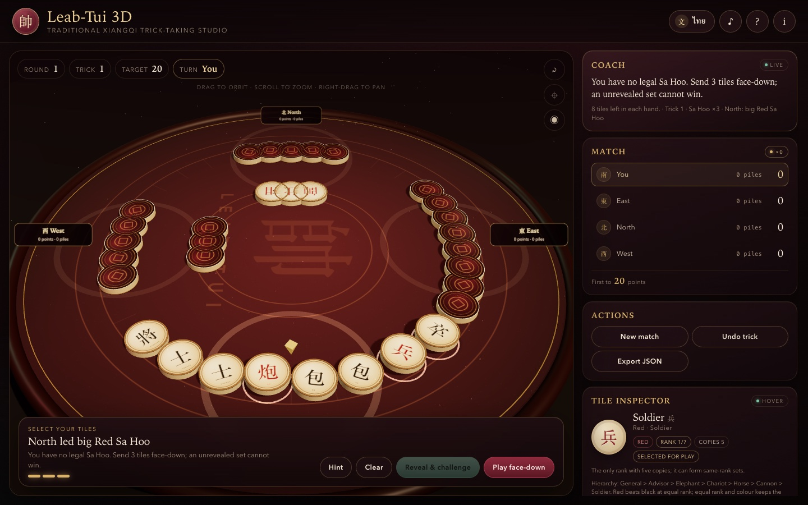
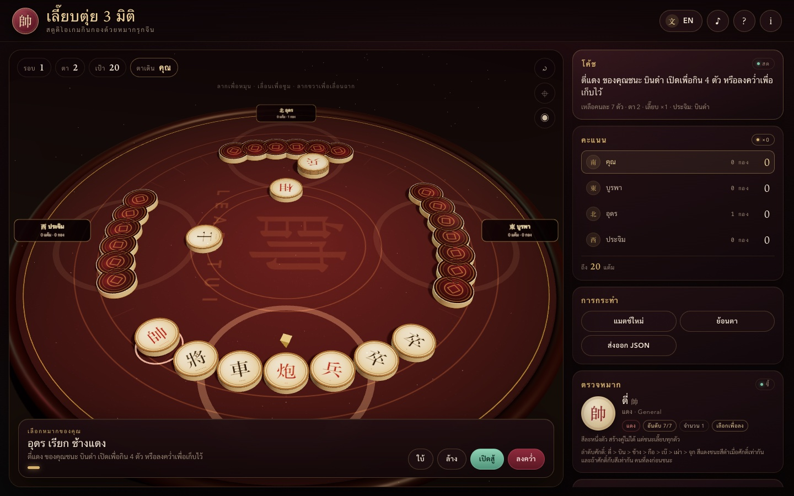
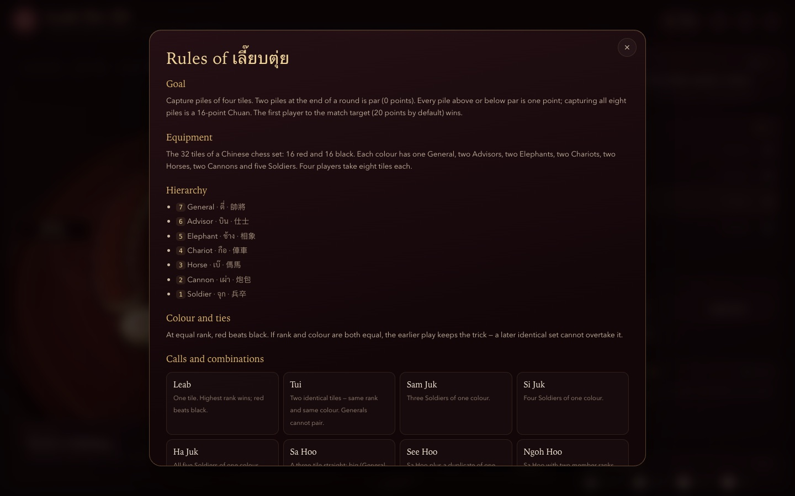
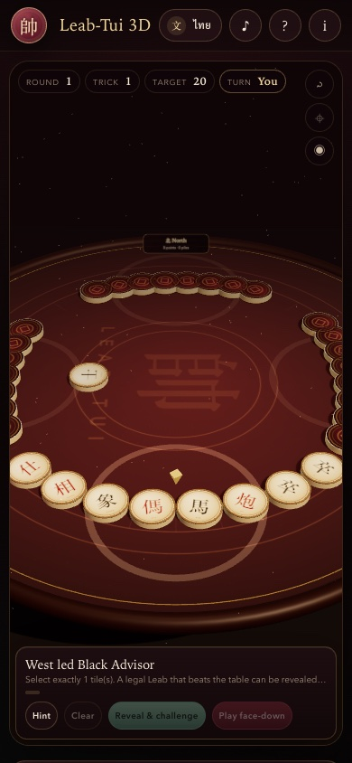

# Leab-Tui 3D — Traditional Xiangqi Trick-Taking Studio

[](https://somphol.github.io/leab-tui-3d/)
[](CHANGELOG.md)
[](LICENSE)
[](docs/ARCHITECTURE.md)
[](https://threejs.org/)

A bilingual, interactive 3D studio for **เลี๊ยบตุ่ย (Leab-Tui)**, the Thai trick-taking game played with the 32 tiles of a Chinese chess (Xiangqi) set. Thirty-two carved tiles, four seats, eight tiles each, and a full rules engine with a beginner coach.

**Live demo:** <https://somphol.github.io/leab-tui-3d/>  
**Stack:** vanilla HTML5, CSS3, ES2022 JavaScript, Three.js r160 (CDN). No build step, no framework, no API keys, no tracking.



## What makes it different

- **A real trick-taking engine, not a toy.** Leab (single), Tui (pair), Sa Hoo, See Hoo, Ngoh Hoo, Lak Hoo, and the Soldier sets; red-beats-black tie-breaking; face-down submissions; revealed-only comparison; the eight-pile Chuan bonus.
- **Carved 3D Xiangqi tiles.** Every tile is a bevelled cylinder with a procedurally painted Hanzi face, raised rim and a lacquered back. Dealing, flipping, playing and capture sweeps are animated with lerped transforms.
- **A table you can orbit.** Drag to rotate, scroll to zoom, right-drag to pan. Reset, top view and a cinematic orbit are one click away.
- **A coach that explains the trick.** The side panel names a legal lead, warns when a set cannot beat the table, counts the remaining tiles and explains rank dominance. It never plays for you.
- **Undo and Learn.** Rewind the last trick and read a side-by-side comparison of your set and the winning set, with the hierarchy in view.
- **Bilingual everywhere.** EN ⇄ ไทย switches the header, HUD, rules, tile names, coach, summaries, log, inspector and ARIA labels without a reload.
- **Synthesised sound.** Shuffles, wooden clacks, flips, sweeps and win/lose stings are generated with the Web Audio API. No audio files, no network requests.
- **Local-first.** Match state, preferences and statistics live in `localStorage`. **Export JSON** downloads a complete, documented game record.

## The game in one minute

| | |
| --- | --- |
| **Players** | 1 human + 3 AI, seated South / East / North / West |
| **Tiles** | 32 Xiangqi tiles: 16 red, 16 black |
| **Deal** | 8 tiles each |
| **Hierarchy** | General 帥/將 > Advisor 仕/士 > Elephant 相/象 > Chariot 俥/車 > Horse 傌/馬 > Cannon 炮/包 > Soldier 兵/卒 |
| **Tie-break** | Red beats black at equal rank; equal rank + colour keeps the earlier play |
| **Calls** | Leab ×1, Tui ×2, Sa Hoo ×3, See Hoo ×4, Ngoh Hoo ×5, Lak Hoo ×6, Soldier sets ×3–5 |
| **Trick** | Everyone sends the called number of tiles. Only revealed sets compete. The winner takes all 4×N tiles and leads next |
| **Scoring** | 2 piles = par (0). Each pile above or below is ±1. All 8 piles = Chuan, **16 points**. First to 20 wins |

Full rules, including the source and the interpretation choices: **[docs/RULES.md](docs/RULES.md)**.

## Quick start

```bash
cd leab-tui-3d
python3 -m http.server 8123
# open http://127.0.0.1:8123/
```

An HTTP server is required because `script.js` is an ES module. The page needs network access for the pinned Three.js CDN; everything else is local. Opening `index.html` directly with `file://` will not load the module in most browsers.

### Controls

| Action | Mouse / keyboard |
| --- | --- |
| Orbit the table | Drag with the left mouse button |
| Zoom | Scroll / pinch |
| Pan | Right-drag |
| Select a tile | Click a face-up tile in your hand |
| Select via the accessible list | Click a chip in **Your hand** |
| Hint / Clear | Buttons, or `H` / `Esc` |
| Lead / Reveal / Play face-down | Buttons under the table |
| Rules / About | `?` and `i` in the header |

See **[docs/CONTROLS.md](docs/CONTROLS.md)** for touch and keyboard details.

## Three screens, one language toggle

| English table with the inspector | ไทย |
| --- | --- |
|  |  |

| Rules drawer | Phone layout |
| --- | --- |
|  |  |

## Run and verify

```bash
# syntax
node --check script.js

# dependency-free release check: files, links, version, i18n, rules invariants
node scripts/check.mjs

# headless rules + browser smoke test (needs Chrome + a local server)
python3 -m http.server 8123 &
node scripts/verify.mjs

# interactive CDP harness
node scripts/browser-check.mjs --url "http://127.0.0.1:8123/?selftest=1"
```

The browser self-test is also available at `?selftest=1`; it prints a 25-check report into the page and sets the document title to `SELFTEST PASS 25/25` or `SELFTEST FAIL n/25`. Verification details and the manual checklist are in **[docs/TESTING.md](docs/TESTING.md)**.

## Project layout

```text
index.html              single page, import map, modals
style.css               dark mahogany visual system, responsive layout
script.js               rules engine, AI, 3D scene, audio, i18n, persistence
scripts/check.mjs       dependency-free static release check
scripts/verify.mjs      headless browser verification
scripts/browser-check.mjs  reusable CDP harness
docs/                   rules, architecture, tests, deployment, reproduction
screenshots/            release screenshots
state.json              build record: time, tokens, model, harness
```

The load order and module boundaries are documented in **[docs/ARCHITECTURE.md](docs/ARCHITECTURE.md)**.

## Design notes

- **The rule engine is pure.** `buildDeck`, `detectCombo`, `compareScores`, `beats`, `allCombos`, `chooseLead` and `chooseFollow` have no DOM or Three.js dependency. The browser self-test exercises them without a GPU.
- **One source of truth.** The 3D scene never owns game state. `scene.sync(state)` maps tiles to hand / centre / capture positions and animates the difference.
- **The coach is computed, not scripted.** It runs the same combo detector and a deterministic AI recommendation, so its advice stays correct as the rules evolve.
- **The export format is versioned.** `leab-tui-3d-save` v1 stores tile IDs and combo descriptors; it never stores live Three.js objects.

## Known limits

- Four-player games only. The traditional two- and three-player variants are not implemented.
- The rules follow the Thai description cited in [docs/RULES.md](docs/RULES.md); where that source is ambiguous, the studio documents a playable interpretation. It is not an official tournament rulebook.
- No online multiplayer, accounts, leaderboards or server-side storage.
- The page is not fully offline: Three.js r160 is loaded from jsDelivr. The rule engine can still be exercised if the CDN fails, but the table will not render.
- Mobile is verified under Chrome device emulation, not on physical iOS/Android hardware.

## Credits

Designed, written, verified and documented in a single session with **OpenCode 2.2.5** and **DeepSeek V4.1 Flash** (`opencode-go/deepseek-v4.1-flash`). The build time, token counts and session ID are recorded in **[STATE.md](STATE.md)** and **[state.json](state.json)**.

Rules reference: Navee Angsuputiphant, “กฏกติกาการเล่น เลี๊ยบตุ่ย” (2016), linked in [docs/RULES.md](docs/RULES.md). Three.js is MIT-licensed; see [THIRD_PARTY_NOTICES.md](THIRD_PARTY_NOTICES.md).

## Licence

MIT. See [LICENSE](LICENSE).
